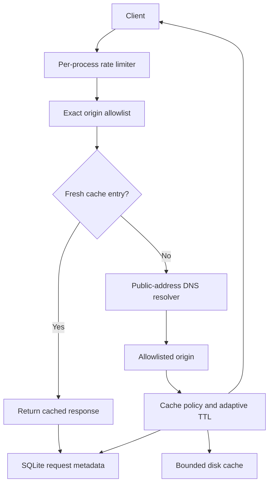

# Architecture

## Request path

## Main modules

- `cdn_proxy_server.py`: HTTP endpoints, target validation, outbound client lifecycle, cache storage, request limiting, analytics, and the conservative adaptive policy.
- `experiments/cache_policy_benchmark.py`: deterministic synthetic comparison of fixed TTL and adaptive TTL.
- `tests/`: unit and storage regression tests.
- `.github/workflows/ci.yml`: supported-Python test matrix, benchmark smoke test, and container build validation.
- `Dockerfile` and `compose.yaml`: portable, non-root deployment with loopback-only host binding by default.
- `DELETE /cache?url=...`: authenticated cache purge for one allowlisted origin URL.

## Important invariants

1. A request target must use HTTP(S), contain no URL credentials, use the scheme's default port, and match an exact configured hostname.
2. DNS results containing non-global addresses are rejected by the outbound resolver. Deployment firewall egress controls remain required.
3. Cache TTL adaptation never extends the origin-approved TTL and cannot override restrictive cache directives.
4. Requests carrying Authorization or Cookie bypass shared cache reads and writes.
5. Responses with Set-Cookie are not cached. Ordinary Vary fields use request-header-specific variant keys; Vary: * is never cached.
6. Cache writes are serialized and enforce a configured disk budget.
7. The statistics endpoint is unavailable unless a bearer token is configured.
8. The service binds to loopback by default outside container-specific configuration.

## Current design limits

This remains a single-process proxy. Rate limits, in-memory policy history, and counters are local to one process. The cache supports origin-side ETag/Last-Modified revalidation for expired entries, but does not yet implement full RFC cache validation, full RFC conditional semantics, multi-range caching, purge APIs, Vary-aware cache keys, or distributed coherence. Those are explicit engineering milestones rather than capabilities to imply prematurely.
